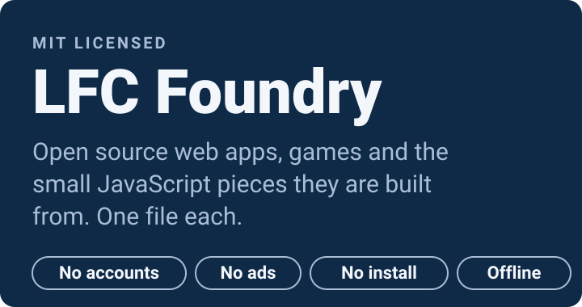
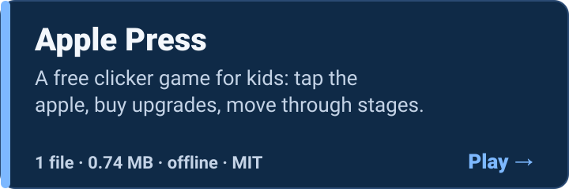
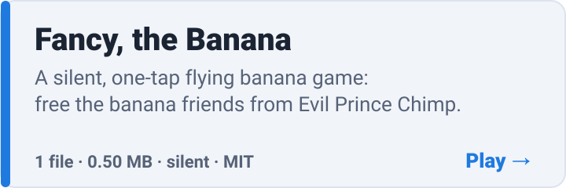
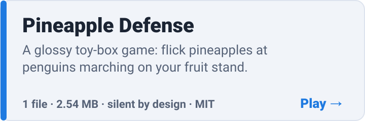
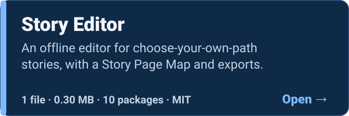

# LFC Foundry

<a href="https://github.com/lfcfoundry/JS-modules"><picture><source media="(prefers-color-scheme: dark)" srcset="https://raw.githubusercontent.com/lfcfoundry/.github/main/profile/images/hero-dark.svg"></picture></a>

**Open source web apps, games and the small JavaScript pieces they are built from. One file each.**

[**Play Apple Press**](https://lfcfoundry.github.io/apple-press/play/) · [**Play Fancy, the Banana**](https://lfcfoundry.github.io/fancy-banana/play/) · [**Play Pineapple Defense**](https://lfcfoundry.github.io/pineapple-defense/play/) · [**Play Thumb Circuit**](https://lfcfoundry.github.io/thumb-circuit/play/) · [**Open Netflow Map**](https://lfcfoundry.github.io/netflow-map/play/) · [**Open the Story Editor**](https://lfcfoundry.github.io/story-editor/play/) · [**Browse JS-modules**](https://lfcfoundry.github.io/JS-modules/)

   

## What it is and how it works

LFC Foundry is a home for open source web apps, games and the small JavaScript pieces they are built from. Each app or game is a single `.html` file that runs entirely in the browser: download it once and open it, with no server, account or install. The pieces are one dependency-free file each that any single-file page can copy in. Every one is built and tested by a person pairing with AI.

None of the apps or games need an install, administrative privileges or any special computing knowledge. The JS-modules pieces are for more seasoned users and developers.

## Why it exists

Software for the web has drifted toward accounts, tracking, ads and dependencies that stop working when a server goes away. We wanted a place where a useful tool or a good game is one file you can keep forever, and where the parts behind it are shared in the open.

- **Easy:** No install, no administrative privileges, no special knowledge.
- **Safe:** No accounts, no tracking, no ads. Nothing is sent anywhere.
- **Offline:** Download a file once and it runs without a network.
- **Open:** MIT licensed. Use, change and share everything.
- **Tested in three browsers:** Firefox, Chromium and WebKitGTK.

## What is new

- **LFC-pack 0.14.7** ([README](https://github.com/lfcfoundry/JS-modules/blob/main/modules/lfc-pack/README.md)): a compact file format for rows of JSON. In our 2026-11-20 cloud runs (measured at 0.12.3, Chromium 156 and Firefox 158; DuckDB-WASM's threaded build is an estimate) its files were 0.5 to 0.7 the size of Parquet at zstd level 3 on taxi trips, orders and logs, and reading 100,000 rows back as plain objects took 30 to 76 ms against 76 to 489 ms for parquet-wasm, hyparquet and DuckDB-WASM. WebKitGTK was not run in that round.
- **lz4-kit 1.1.2, a new module, in the main branch and not yet released** ([README](https://github.com/lfcfoundry/JS-modules/blob/main/modules/lz4-kit/README.md)): LZ4 compress and decompress (raw blocks and the standard .lz4 frame, fast mode and levels 1 to 12) in WebAssembly, built from the fixed LZ4 1.11.1. On 4 MiB of log lines, with its optional view setting, it compresses 7.3 to 7.9 times faster than the browser's gzip, but its output is 1.7 to 1.9 times bigger. Against the other LZ4 libraries (lz4js, lz4-wasm, wasm-lz4 and gorhill/lz4-wasm) it compresses 20 to 36% faster than the fastest of them and decompresses 2.6 to 3.5 times faster (Chromium 156, Firefox 158 and WebKitGTK 2.52.6, cloud; no phone or laptop run yet).
- **zstd-kit 1.0.0, a new module** ([README](https://github.com/lfcfoundry/JS-modules/blob/main/modules/zstd-kit/README.md)): Zstandard compress and decompress, XXH64 and CRC-32 in WebAssembly. It decompresses 2.6 to 3.5 times faster than fzstd and 2.4 to 2.6 times faster than the browser's own gzip on 4 MB of log lines (Chromium 156, Firefox 158 and WebKitGTK 2.52.6, cloud). Its output is a little larger than gzip at level 3.
- **Netflow Map** ([repository](https://github.com/lfcfoundry/netflow-map), [open it](https://lfcfoundry.github.io/netflow-map/play/)): a new Sift choice in crossing search slides each box to its best place in its row. On a 1,000-item map it left 4,222 crossings against 4,679 by default and 4,494 for Graphviz, at about 1.3 times the layout time. It is off unless you pick it. A Credits button lists the ideas the app is built on. Big nested views (treemap, icicle, sunburst, circle pack) also open and switch faster: on a 50,000-item map the first treemap picture took 1.64 s instead of 2.13 s in Chromium 156 and 1.49 s instead of 1.74 s in Firefox 158, and switching views took 18 to 30% less time in both (circle pack in Firefox unchanged). Drawing tiles saves a further 8% in Chromium and nothing measurable in Firefox.
- **Thumb Circuit** ([repository](https://github.com/lfcfoundry/thumb-circuit), [play the sample](https://lfcfoundry.github.io/thumb-circuit/play/)): a one-thumb racing game for phones. Sample version 7.78 has a story campaign, "Road to the Big Top," with six towns, three races and a duel in each. It is a test build and changes often.
- **LFCP Workbench** ([repository](https://github.com/lfcfoundry/lfcp-workbench)): a data multitool that runs in the browser, built on LFC-pack. It is in development: it imports CSV and TSV files, shows them in a grid you can sort and filter, and exports what you see as CSV. On a generated 300 MB file of 7 million rows (cloud Chromium 156, Firefox 158 and WebKitGTK 2.52.6, one run each) the saved copy is 58% smaller than before, import is 6 to 32% faster, and the first sort by a number column takes 115 to 176 ms instead of 499 to 671 ms. DuckDB-WASM is still faster at sorting (25 to 74 ms) and at import in Chromium, level at import in WebKitGTK and slower at import in Firefox. A 100 MB file of 2.4 million rows passed its self-test on an Android phone in Chrome 157: import 4.0 s, saved size 1.16 MB, sorts in 23 to 145 ms.
- **Credits pages**: every idea and every piece of outside code we build on is listed with its authors and a link to the original. See the [JS-modules credits](https://github.com/lfcfoundry/JS-modules/blob/main/CREDITS.md) and the [Netflow Map credits](https://github.com/lfcfoundry/netflow-map/blob/main/docs/CREDITS.md).

## By the numbers

- Apps and games: **6**, one file each (the Workbench is still in development)
- Modules and tools: **53**, each with a README and a size
- Story Editor packages: **10**
- Accounts, trackers or ads: **0**

Size of each app's one file on the main branch: Pineapple Defense 2.75 MB, Netflow Map 2.22 MB, Apple Press 0.75 MB, Thumb Circuit 0.67 MB, Fancy, the Banana 0.50 MB, Story Editor 0.32 MB.

## 🧰 What's inside

<a href="https://lfcfoundry.github.io/apple-press/play/"><picture><source media="(prefers-color-scheme: dark)" srcset="https://raw.githubusercontent.com/lfcfoundry/.github/main/profile/images/apple-press-dark.svg"></picture></a>

<a href="https://lfcfoundry.github.io/fancy-banana/play/"><picture><source media="(prefers-color-scheme: dark)" srcset="https://raw.githubusercontent.com/lfcfoundry/.github/main/profile/images/fancy-banana-dark.svg"></picture></a>

<a href="https://lfcfoundry.github.io/pineapple-defense/play/"><picture><source media="(prefers-color-scheme: dark)" srcset="https://raw.githubusercontent.com/lfcfoundry/.github/main/profile/images/pineapple-defense-dark.svg"></picture></a>

<a href="https://lfcfoundry.github.io/story-editor/play/"><picture><source media="(prefers-color-scheme: dark)" srcset="https://raw.githubusercontent.com/lfcfoundry/.github/main/profile/images/story-editor-dark.svg"></picture></a>

**Games and apps** (each one is a single `.html` file): [Thumb Circuit](https://github.com/lfcfoundry/thumb-circuit) ([play](https://lfcfoundry.github.io/thumb-circuit/play/)), [Netflow Map](https://github.com/lfcfoundry/netflow-map) ([open](https://lfcfoundry.github.io/netflow-map/play/)), [Apple Press](https://github.com/lfcfoundry/apple-press) ([play](https://lfcfoundry.github.io/apple-press/play/)), [Fancy, the Banana](https://github.com/lfcfoundry/fancy-banana) ([play](https://lfcfoundry.github.io/fancy-banana/play/)), [Pineapple Defense](https://github.com/lfcfoundry/pineapple-defense) ([play](https://lfcfoundry.github.io/pineapple-defense/play/)) and the [Story Editor](https://github.com/lfcfoundry/story-editor) ([open](https://lfcfoundry.github.io/story-editor/play/)). Still in development: the [LFCP Workbench](https://github.com/lfcfoundry/lfcp-workbench).

**[JS-modules](https://github.com/lfcfoundry/JS-modules)** are small, dependency-free pieces that any single-file page can copy in, with live demos at https://lfcfoundry.github.io/JS-modules/. Every one has a README, a changelog and a size; the [full tables](https://github.com/lfcfoundry/JS-modules#pick-a-piece) list the file size of each.

**Modules & Tools (53)**

* Device and browser adaptation: [env-probes](https://github.com/lfcfoundry/JS-modules/blob/main/modules/env-probes/README.md), [field-report](https://github.com/lfcfoundry/JS-modules/blob/main/modules/field-report/README.md), [frame-kit](https://github.com/lfcfoundry/JS-modules/blob/main/modules/frame-kit/README.md), [fx-governor](https://github.com/lfcfoundry/JS-modules/blob/main/modules/fx-governor/README.md), [image-decode](https://github.com/lfcfoundry/JS-modules/blob/main/modules/image-decode/README.md), [slow-note](https://github.com/lfcfoundry/JS-modules/blob/main/modules/slow-note/README.md)
* Saving and data safety: [save-kit](https://github.com/lfcfoundry/JS-modules/blob/main/modules/save-kit/README.md), [tab-guard](https://github.com/lfcfoundry/JS-modules/blob/main/modules/tab-guard/README.md)
* Games * Looks and effects: [cartoon-3d-kit](https://github.com/lfcfoundry/JS-modules/blob/main/modules/cartoon-3d-kit/README.md), [fly-to-mini](https://github.com/lfcfoundry/JS-modules/blob/main/modules/fly-to-mini/README.md), [gpu-blur](https://github.com/lfcfoundry/JS-modules/blob/main/modules/gpu-blur/README.md), [sprite-baker](https://github.com/lfcfoundry/JS-modules/blob/main/modules/sprite-baker/README.md), [stage-curtains](https://github.com/lfcfoundry/JS-modules/blob/main/modules/stage-curtains/README.md), [sticker-text](https://github.com/lfcfoundry/JS-modules/blob/main/modules/sticker-text/README.md)
* Games * Controls: [back-close](https://github.com/lfcfoundry/JS-modules/blob/main/modules/back-close/README.md), [hold-press](https://github.com/lfcfoundry/JS-modules/blob/main/modules/hold-press/README.md), [pad-nav](https://github.com/lfcfoundry/JS-modules/blob/main/modules/pad-nav/README.md)
* Games * Assist: [grown-ups-door](https://github.com/lfcfoundry/JS-modules/blob/main/modules/grown-ups-door/README.md), [spotlight-tour](https://github.com/lfcfoundry/JS-modules/blob/main/modules/spotlight-tour/README.md)
* Games * Math: [idle-core](https://github.com/lfcfoundry/JS-modules/blob/main/modules/idle-core/README.md)
* Games * Testing: [canvas-probe](https://github.com/lfcfoundry/JS-modules/blob/main/tools/canvas-probe/README.md), [firefox-stand-in](https://github.com/lfcfoundry/JS-modules/blob/main/tools/firefox-stand-in/README.md), [fuzz-kit](https://github.com/lfcfoundry/JS-modules/blob/main/tools/fuzz-kit/README.md), [speed-guard](https://github.com/lfcfoundry/JS-modules/blob/main/tools/speed-guard/README.md), [speed-lab](https://github.com/lfcfoundry/JS-modules/blob/main/tools/speed-lab/README.md), [storage-probe](https://github.com/lfcfoundry/JS-modules/blob/main/tools/storage-probe/README.md), [test-isolation](https://github.com/lfcfoundry/JS-modules/blob/main/tools/test-isolation/README.md), [test-runner](https://github.com/lfcfoundry/JS-modules/blob/main/tools/test-runner/README.md), [webkit-driver](https://github.com/lfcfoundry/JS-modules/blob/main/tools/webkit-driver/README.md)
* App * Efficiency: [elias-fano](https://github.com/lfcfoundry/JS-modules/blob/main/modules/elias-fano/README.md), [lfc-pack](https://github.com/lfcfoundry/JS-modules/blob/main/modules/lfc-pack/README.md), [lz4-kit](https://github.com/lfcfoundry/JS-modules/blob/main/modules/lz4-kit/README.md), [memory-compression](https://github.com/lfcfoundry/JS-modules/blob/main/modules/memory-compression/README.md), [single-file-tools](https://github.com/lfcfoundry/JS-modules/blob/main/tools/single-file-tools/README.md), [text-columns](https://github.com/lfcfoundry/JS-modules/blob/main/modules/text-columns/README.md), [zstd-kit](https://github.com/lfcfoundry/JS-modules/blob/main/modules/zstd-kit/README.md)
* Graphs and simulation: [graph-walk](https://github.com/lfcfoundry/JS-modules/blob/main/modules/graph-walk/README.md), [walker-sim](https://github.com/lfcfoundry/JS-modules/blob/main/modules/walker-sim/README.md)
* Visualization: [clip-writer](https://github.com/lfcfoundry/JS-modules/blob/main/modules/clip-writer/README.md), [gif-writer](https://github.com/lfcfoundry/JS-modules/blob/main/modules/gif-writer/README.md), [netflow-circular](https://github.com/lfcfoundry/JS-modules/blob/main/modules/netflow-circular/README.md), [netflow-engine](https://github.com/lfcfoundry/JS-modules/blob/main/modules/netflow-engine/README.md), [netflow-hierarchy](https://github.com/lfcfoundry/JS-modules/blob/main/modules/netflow-hierarchy/README.md), [netflow-layers](https://github.com/lfcfoundry/JS-modules/blob/main/modules/netflow-layers/README.md), [netflow-plot](https://github.com/lfcfoundry/JS-modules/blob/main/modules/netflow-plot/README.md), [netflow-sankey](https://github.com/lfcfoundry/JS-modules/blob/main/modules/netflow-sankey/README.md), [netflow-scene](https://github.com/lfcfoundry/JS-modules/blob/main/modules/netflow-scene/README.md)
* Size and packaging: [lzma-decode](https://github.com/lfcfoundry/JS-modules/blob/main/modules/lzma-decode/README.md), [lzma-pack](https://github.com/lfcfoundry/JS-modules/blob/main/tools/lzma-pack/README.md), [pcodec-js](https://github.com/lfcfoundry/JS-modules/blob/main/modules/pcodec-js/README.md), [ppmd-decode](https://github.com/lfcfoundry/JS-modules/blob/main/modules/ppmd-decode/README.md), [ppmd-pack](https://github.com/lfcfoundry/JS-modules/blob/main/tools/ppmd-pack/README.md), [zip-open](https://github.com/lfcfoundry/JS-modules/blob/main/modules/zip-open/README.md)

**Story Editor packages (10)**

* Story data: [story-diff](https://github.com/lfcfoundry/story-editor/blob/main/packages/story-diff/README.md), [story-format](https://github.com/lfcfoundry/story-editor/blob/main/packages/story-format/README.md), [story-outline](https://github.com/lfcfoundry/story-editor/blob/main/packages/story-outline/README.md), [twine-import](https://github.com/lfcfoundry/story-editor/blob/main/packages/twine-import/README.md)
* Story validation: [story-check](https://github.com/lfcfoundry/story-editor/blob/main/packages/story-check/README.md)
* Story flow: [story-map](https://github.com/lfcfoundry/story-editor/blob/main/packages/story-map/README.md)
* Story build and distribute: [story-player](https://github.com/lfcfoundry/story-editor/blob/main/packages/story-player/README.md)
* Story packaging: [zip-page](https://github.com/lfcfoundry/story-editor/blob/main/packages/zip-page/README.md)
* Story testing: [contract-kit](https://github.com/lfcfoundry/story-editor/blob/main/packages/contract-kit/README.md), [qa-kit](https://github.com/lfcfoundry/story-editor/blob/main/packages/qa-kit/README.md)

**AI knowledge base (1)**

* Working with an AI helper: [ai-collab-kit](https://github.com/lfcfoundry/story-editor/blob/main/packages/ai-collab-kit/README.md)

---

## 📜 Open Source & Branding Policy

All software produced by the LFC Foundry is distributed under the **MIT License**. You are completely free to use, modify, fork, and even commercially monetize the code. 

### ⚠️ Trademark & Attribution Notice
While the underlying source code is open, the names **"LFC Foundry"**, **"LFC Core"**,  **"JNFoo"**,and our project branding are reserved identifiers. 
* If you fork or redistribute our files, you **must preserve the original copyright notice** inside the file comments as required by the MIT License.
* If you modify our applications to launch your own downstream or commercial product, you **must change the brand name** and remove the LFC Foundry identity from your user interface.

📍 *Built for the permanent, independent web.*
